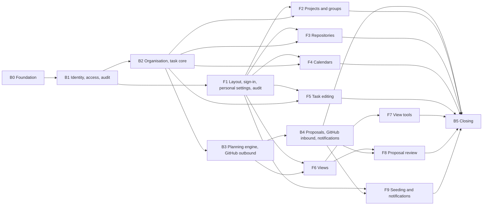

# Implementation plan for the solution components

This plan puts the 114 solution components (SCs) in [`graph/`](../graph/) in the order they are built, and shows which blocks of them can be built at the same time. It sets only the order. What each SC is, what it delivers and when it is done are in the SC's own file, and this plan does not repeat them.

- Drafted by Claude for issue #15, 2026-11-03. It awaits the owner's confirmation.
- The order comes from what each SC needs in order to work: the FRs, DDs and SCs it links, and the service-layer modules it calls. Where an SC names no dependency, the order shown is Claude's reading of it.

## How to read it

- There are two lanes. The **backend lane** (B) has waves B0 to B5, run one after the other. The **frontend lane** (F) has blocks F1 to F9. Each F block can start once the backend blocks it needs are done, so the frontend runs alongside the backend, about one wave behind.
- Blocks in the same wave have no dependencies on each other and can run in parallel, unless the **Needs** column names another block in the same wave.
- Inside a block, `→` means "after", `∥` means "in parallel", and `;` separates chains that run in parallel. Brackets group SCs: `A → (B; C → D)` means that once A is done, B and the chain C → D run in parallel.
- **Σ effort** adds up the `effort` fields of the SCs in the block. It shows how big a block is, for balancing parallel work. It is not a schedule.

## Cross-cutting tracks

Five SCs grow with every block, not in one go. They are opened in B0 and closed in B5.2:

| SC | Opened in | Grows with | Closed |
|---|---|---|---|
| [SC-073](../graph/SC-073-database-schema-migrations.md) | B0.1 | Each backend block adds its tables to the schema and generates its migration. | B5.2 |
| [SC-026](../graph/SC-026-rest-api-routes.md) | B0.2 | Each backend block adds its group of routes. | B5.2, once every F block is done |
| [SC-063](../graph/SC-063-openapi-description-of-the-rest-api.md) | B0.2 | Generated from the routes as they are added. | B5.2 |
| [SC-028](../graph/SC-028-application-docker-image.md) | B0.3 | Packages each backend and frontend part as it lands. | B5.2 |
| [SC-029](../graph/SC-029-docker-compose-file.md) | B0.3 | Runs the image from B0.3 on. | B5.2 |

## Overview

Wave level only; the tables below give the blocks and their exact dependencies.

## Backend lane

### B0: Foundation

| Block | Order | Needs | Σ effort |
|---|---|---|---|
| B0.1 Config and database | [SC-109](../graph/SC-109-configuration-loader.md) → [SC-073](../graph/SC-073-database-schema-migrations.md) (opens) → [SC-074](../graph/SC-074-migration-step-at-container-start.md) | — | 11 |
| B0.2 HTTP skeleton | [SC-026](../graph/SC-026-rest-api-routes.md) (opens) → [SC-063](../graph/SC-063-openapi-description-of-the-rest-api.md) (opens) | [SC-109](../graph/SC-109-configuration-loader.md) | 9 |
| B0.3 Packaging | [SC-028](../graph/SC-028-application-docker-image.md) (opens) → [SC-029](../graph/SC-029-docker-compose-file.md) | B0.1, B0.2 | 3 |
| B0.4 GitHub App access | [SC-108](../graph/SC-108-github-app-tokens.md) → [SC-106](../graph/SC-106-github-app-client.md) | [SC-109](../graph/SC-109-configuration-loader.md) | 4 |

B0.2 and B0.4 start as soon as [SC-109](../graph/SC-109-configuration-loader.md) is done.

### B1: Identity, access and audit

| Block | Order | Needs | Σ effort |
|---|---|---|---|
| B1.1 Accounts and sessions | [SC-015](../graph/SC-015-account-administration.md) → ([SC-053](../graph/SC-053-first-system-admin-bootstrap.md); [SC-052](../graph/SC-052-sign-in.md) → [SC-107](../graph/SC-107-session-check.md); [SC-054](../graph/SC-054-github-account-link.md)) | B0 | 10 |
| B1.2 API tokens | [SC-016](../graph/SC-016-personal-access-token-management.md) → [SC-055](../graph/SC-055-token-authentication.md) | [SC-015](../graph/SC-015-account-administration.md) | 4 |
| B1.3 Projects and roles | [SC-014](../graph/SC-014-project-role-store.md) → ([SC-049](../graph/SC-049-role-permission-checks.md) ∥ [SC-050](../graph/SC-050-view-read-filter.md) ∥ [SC-051](../graph/SC-051-not-visible-project-response.md) ∥ [SC-116](../graph/SC-116-project-search.md); [SC-017](../graph/SC-017-project-creation.md) → [SC-056](../graph/SC-056-project-name-uniqueness-check.md)) | [SC-015](../graph/SC-015-account-administration.md) |12 |
| B1.4 Audit log | [SC-013](../graph/SC-013-audit-log.md) | [SC-015](../graph/SC-015-account-administration.md) | 3 |

[SC-015](../graph/SC-015-account-administration.md) is the one SC in this wave that the others wait for. The audit log comes this early so that every module after it records its changes from the start.

### B2: Organisation and task core

| Block | Order | Needs | Σ effort |
|---|---|---|---|
| B2.1 Groups | [SC-018](../graph/SC-018-group-creation-and-listing.md) → ([SC-057](../graph/SC-057-group-membership.md) ∥ [SC-058](../graph/SC-058-group-project-assignment.md)) | B1.3 | 6 |
| B2.2 Repositories | [SC-019](../graph/SC-019-repository-registry.md) → ([SC-110](../graph/SC-110-project-repository-approvals.md) ∥ [SC-111](../graph/SC-111-receiving-project-register.md)) | B1.3, B0.4 | 8 |
| B2.3 Calendars | [SC-008](../graph/SC-008-calendar-and-availability-module-of-the-service-la.md) | B1.1 | 5 |
| B2.4 Tasks | [SC-001](../graph/SC-001-task-record-module.md) → ([SC-002](../graph/SC-002-task-relation-module-of-the-service-layer.md) ∥ [SC-003](../graph/SC-003-task-status-transitions.md) ∥ [SC-005](../graph/SC-005-eligibility-and-assignment-module-of-the-service-l.md)) → ([SC-037](../graph/SC-037-task-status-constraint-checks.md) ∥ [SC-038](../graph/SC-038-task-cancellation.md) ∥ [SC-039](../graph/SC-039-person-load-percentage-rules.md)); [SC-036](../graph/SC-036-task-repository-assignment.md) | B1.3; [SC-036](../graph/SC-036-task-repository-assignment.md) also [SC-110](../graph/SC-110-project-repository-approvals.md) (B2.2) | 21 |

[SC-037](../graph/SC-037-task-status-constraint-checks.md) and [SC-038](../graph/SC-038-task-cancellation.md) wait for both [SC-002](../graph/SC-002-task-relation-module-of-the-service-layer.md) and [SC-003](../graph/SC-003-task-status-transitions.md). [SC-039](../graph/SC-039-person-load-percentage-rules.md) waits for [SC-005](../graph/SC-005-eligibility-and-assignment-module-of-the-service-l.md) only.

### B3: Planning engine and GitHub outbound

| Block | Order | Needs | Σ effort |
|---|---|---|---|
| B3.1 Scheduling | [SC-004](../graph/SC-004-scheduler.md) → ([SC-007](../graph/SC-007-milestone-and-dependency-violation-detector.md) ∥ [SC-021](../graph/SC-021-mermaid-gantt-exporter.md)) | B2.3, B2.4 | 18 |
| B3.2 Person load | [SC-006](../graph/SC-006-daily-person-load-aggregator.md) → ([SC-040](../graph/SC-040-overload-detector.md) → [SC-042](../graph/SC-042-assignee-availability-flag-detector.md); [SC-041](../graph/SC-041-unassigned-task-load-rating.md)) | B2.3, B2.4 | 13 |
| B3.3 Red flags | [SC-043](../graph/SC-043-red-flag-register.md) | [SC-007](../graph/SC-007-milestone-and-dependency-violation-detector.md) (B3.1), [SC-042](../graph/SC-042-assignee-availability-flag-detector.md) (B3.2) | 2 |
| B3.4 Baselines | [SC-009](../graph/SC-009-baseline-snapshots.md) → [SC-044](../graph/SC-044-variance-calculator.md) | B2.4 | 4 |
| B3.5 Saved views | [SC-020](../graph/SC-020-saved-view-module-of-the-service-layer.md) → [SC-059](../graph/SC-059-group-deletion.md) | B2.1, B2.4 | 6 |
| B3.6 GitHub mirror | [SC-022](../graph/SC-022-github-planning-mirror.md) → ([SC-060](../graph/SC-060-github-issue-creator.md) ∥ [SC-061](../graph/SC-061-github-not-planned-closer.md) ∥ [SC-062](../graph/SC-062-github-revert-commenter.md)) | B0.4, B2.2, B2.4, [SC-054](../graph/SC-054-github-account-link.md) | 9 |
| B3.7 Seeding | [SC-025](../graph/SC-025-github-seeding-importer.md) | B0.4, B2.2, B2.4, [SC-054](../graph/SC-054-github-account-link.md) | 8 |

B3.3 joins B3.1 and B3.2. B3.6 and B3.7 do not need the planning engine. They are in this wave because they need the task core from B2.4.

### B4: Proposals, GitHub inbound and notifications

| Block | Order | Needs | Σ effort |
|---|---|---|---|
| B4.1 Proposals | [SC-010](../graph/SC-010-proposal-store.md) → ([SC-045](../graph/SC-045-proposal-edit-and-reject-actions.md) ∥ [SC-046](../graph/SC-046-proposal-expiry-rule.md) ∥ [SC-047](../graph/SC-047-proposal-conflict-detector.md) ∥ [SC-011](../graph/SC-011-proposal-preview.md)) → [SC-048](../graph/SC-048-proposal-approval.md) | B3.1, B3.3, B1.4 | 19 |
| B4.2 GitHub inbound | [SC-023](../graph/SC-023-github-change-handler.md) → ([SC-105](../graph/SC-105-github-webhook-endpoint.md) ∥ [SC-024](../graph/SC-024-re-check-timer.md)) | B3.6, [SC-037](../graph/SC-037-task-status-constraint-checks.md), [SC-038](../graph/SC-038-task-cancellation.md), [SC-111](../graph/SC-111-receiving-project-register.md) | 18 |
| B4.3 Notifications | [SC-012](../graph/SC-012-notification-module-of-the-service-layer.md) | B3.3, B2.2 | 5 |

[SC-048](../graph/SC-048-proposal-approval.md) waits for [SC-011](../graph/SC-011-proposal-preview.md) and [SC-047](../graph/SC-047-proposal-conflict-detector.md). B4.3 can start with the wave. Its notification for a proposal waiting for review is connected once [SC-010](../graph/SC-010-proposal-store.md) is done, and its notification for a revert once [SC-023](../graph/SC-023-github-change-handler.md) is done.

### B5: Closing

| Block | Order | Needs | Σ effort |
|---|---|---|---|
| B5.1 MCP server | [SC-027](../graph/SC-027-mcp-server-endpoint.md) | [SC-055](../graph/SC-055-token-authentication.md), B4.1, B4.3 | 5 |
| B5.2 Close the tracks | [SC-073](../graph/SC-073-database-schema-migrations.md), [SC-026](../graph/SC-026-rest-api-routes.md), [SC-063](../graph/SC-063-openapi-description-of-the-rest-api.md), [SC-028](../graph/SC-028-application-docker-image.md), [SC-029](../graph/SC-029-docker-compose-file.md) checked against their done criteria | every B and F block | — |

## Frontend lane

[SC-113](../graph/SC-113-frontend-layout.md) and [SC-075](../graph/SC-075-sign-in-page.md) come first in the frontend, so every other F block also waits for both of them in F1. [SC-115](../graph/SC-115-signed-in-person-menu.md) brings up screens from F1 and F4; each entry works once its screen is done.

| Block | Order | Needs | Σ effort |
|---|---|---|---|
| F1 Layout, sign-in, personal settings, audit | [SC-113](../graph/SC-113-frontend-layout.md) → ([SC-114](../graph/SC-114-project-search-bar.md) ∥ [SC-115](../graph/SC-115-signed-in-person-menu.md)); [SC-075](../graph/SC-075-sign-in-page.md) → ([SC-076](../graph/SC-076-account-administration-screen.md) ∥ [SC-077](../graph/SC-077-github-account-link-setting.md) ∥ [SC-078](../graph/SC-078-personal-access-token-page.md) ∥ [SC-094](../graph/SC-094-audit-log-viewer.md)) | B1 | 15 |
| F2 Projects and groups | [SC-079](../graph/SC-079-project-creation-form.md) ∥ [SC-080](../graph/SC-080-project-members-and-roles-screen.md) ∥ [SC-082](../graph/SC-082-group-list-screen.md) ∥ [SC-083](../graph/SC-083-group-members-screen.md) ∥ [SC-084](../graph/SC-084-group-projects-screen.md) | B1.3, B2.1; [SC-082](../graph/SC-082-group-list-screen.md)'s group deletion also [SC-059](../graph/SC-059-group-deletion.md) (B3.5) | 9 |
| F3 Repositories | [SC-085](../graph/SC-085-repository-registration-screen.md) ∥ [SC-086](../graph/SC-086-repository-admins-screen.md) ∥ [SC-087](../graph/SC-087-repository-request-inbox.md); [SC-081](../graph/SC-081-project-repository-settings-screen.md) → [SC-112](../graph/SC-112-receiving-project-control.md) | B2.2 | 10 |
| F4 Calendars | [SC-088](../graph/SC-088-capacity-and-absences-screen.md) ∥ [SC-089](../graph/SC-089-personal-working-calendar-screen.md) ∥ [SC-090](../graph/SC-090-company-calendar-screen.md) | B2.3 | 7 |
| F5 Task editing | [SC-098](../graph/SC-098-task-details-editor.md) ∥ [SC-099](../graph/SC-099-eligibility-expression-editor.md) ∥ [SC-100](../graph/SC-100-assignment-editor.md) ∥ [SC-101](../graph/SC-101-task-relation-editor.md) ∥ [SC-102](../graph/SC-102-task-cancel-action.md) | B2.4 | 12 |
| F6 Views | [SC-030](../graph/SC-030-kanban-view-component.md); [SC-031](../graph/SC-031-gantt-timeline.md) → ([SC-064](../graph/SC-064-gantt-unscheduled-and-cancelled-tasks.md) ∥ [SC-065](../graph/SC-065-gantt-baseline-bars.md) ∥ [SC-066](../graph/SC-066-gantt-cross-project-dependency-lines.md) ∥ [SC-067](../graph/SC-067-gantt-in-place-editing.md)); [SC-032](../graph/SC-032-person-load-chart.md) → [SC-069](../graph/SC-069-unassigned-task-rating-panel.md); [SC-033](../graph/SC-033-baseline-variance-view-component.md) | B3.1 to B3.4 | 36 |
| F7 View tools | [SC-091](../graph/SC-091-saved-view-editor.md) → [SC-092](../graph/SC-092-saved-view-filter-builder.md); [SC-096](../graph/SC-096-gantt-export-dialog.md); [SC-097](../graph/SC-097-baseline-save-dialog.md) | F6, B3.5 | 8 |
| F8 Proposal review | [SC-034](../graph/SC-034-proposal-preview-screen.md) → ([SC-070](../graph/SC-070-proposal-conflict-panel.md) ∥ [SC-071](../graph/SC-071-proposal-editor.md) ∥ [SC-072](../graph/SC-072-proposal-approve-and-reject-controls.md)); [SC-068](../graph/SC-068-gantt-proposal-overlay.md) | B4.1, [SC-031](../graph/SC-031-gantt-timeline.md) (F6) | 13 |
| F9 Seeding and notifications | [SC-095](../graph/SC-095-project-seeding-screen.md) ∥ [SC-035](../graph/SC-035-in-app-notification-list.md) ∥ [SC-093](../graph/SC-093-subscription-controls.md) | [SC-095](../graph/SC-095-project-seeding-screen.md): B3.7; [SC-035](../graph/SC-035-in-app-notification-list.md), [SC-093](../graph/SC-093-subscription-controls.md): B4.3 | 6 |

F6 can start with [SC-030](../graph/SC-030-kanban-view-component.md) and [SC-031](../graph/SC-031-gantt-timeline.md) before [SC-043](../graph/SC-043-red-flag-register.md), but red flags appear on the Gantt only once B3.3 is done. [SC-030](../graph/SC-030-kanban-view-component.md)'s pending proposal overlay is done in F8, together with [SC-068](../graph/SC-068-gantt-proposal-overlay.md).

## Critical path

The longest chain of dependent work is:

[SC-109](../graph/SC-109-configuration-loader.md) → [SC-073](../graph/SC-073-database-schema-migrations.md) → [SC-074](../graph/SC-074-migration-step-at-container-start.md) → [SC-015](../graph/SC-015-account-administration.md) → [SC-014](../graph/SC-014-project-role-store.md) → [SC-049](../graph/SC-049-role-permission-checks.md) → [SC-001](../graph/SC-001-task-record-module.md) → [SC-002](../graph/SC-002-task-relation-module-of-the-service-layer.md) → [SC-004](../graph/SC-004-scheduler.md) → [SC-007](../graph/SC-007-milestone-and-dependency-violation-detector.md) → [SC-043](../graph/SC-043-red-flag-register.md) → [SC-010](../graph/SC-010-proposal-store.md) → [SC-011](../graph/SC-011-proposal-preview.md) → [SC-048](../graph/SC-048-proposal-approval.md) → [SC-027](../graph/SC-027-mcp-server-endpoint.md) and F8

[SC-004](../graph/SC-004-scheduler.md) is the largest single SC on the path. A slip in [SC-004](../graph/SC-004-scheduler.md), or in anything before it on the path, delays the whole plan. The other heavy chain, [SC-108](../graph/SC-108-github-app-tokens.md) → [SC-106](../graph/SC-106-github-app-client.md) → [SC-022](../graph/SC-022-github-planning-mirror.md) → [SC-023](../graph/SC-023-github-change-handler.md), finishes well before the critical path does, so it has slack.

## Coverage

All 114 SCs appear in exactly one block above, apart from B5.2, which names the five tracks again to close them: 67 in the backend lane (effort 203) and 47 in the frontend lane (effort 116). SC-103 and SC-104 are retired and not in the graph.

## Status

| SC | Status | Issue | PR |
|---|---|---|---|
| SC-109 | implemented | #21 | https://github.com/csillagu/cold-seance/pull/22 |
| SC-026 | opened | #23 | https://github.com/csillagu/cold-seance/pull/24 |
| SC-063 | opened | #25 | https://github.com/csillagu/cold-seance/pull/26 |
| SC-073 | opened | #27 | https://github.com/csillagu/cold-seance/pull/28 |
| SC-074 | implemented | #29 | https://github.com/csillagu/cold-seance/pull/30 |
| SC-028 | opened | #31 | https://github.com/csillagu/cold-seance/pull/32 |
| SC-029 | opened | #33 | https://github.com/csillagu/cold-seance/pull/34 |
| SC-108 | implemented | #35 | https://github.com/csillagu/cold-seance/pull/36 |
| SC-109 | implemented | #39 | https://github.com/csillagu/cold-seance/pull/40 |
| SC-108 | implemented | #39 | https://github.com/csillagu/cold-seance/pull/40 |
| SC-106 | implemented | #41 | https://github.com/csillagu/cold-seance/pull/42 |
| SC-015 | implemented | #43 | https://github.com/csillagu/cold-seance/pull/44 |
| SC-013 | implemented | #45 | https://github.com/csillagu/cold-seance/pull/46 |
| SC-014 | implemented | #47 | https://github.com/csillagu/cold-seance/pull/50 |
| SC-016 | implemented | #48 | https://github.com/csillagu/cold-seance/pull/50 |
| SC-017 | implemented | #49 | https://github.com/csillagu/cold-seance/pull/50 |
| SC-049 | implemented | #51 | https://github.com/csillagu/cold-seance/pull/50 |
| SC-050 | implemented | #52 | https://github.com/csillagu/cold-seance/pull/50 |
| SC-051 | implemented | #53 | https://github.com/csillagu/cold-seance/pull/50 |
| SC-052 | implemented | #54 | https://github.com/csillagu/cold-seance/pull/50 |
| SC-053 | implemented | #55 | https://github.com/csillagu/cold-seance/pull/50 |
| SC-054 | implemented | #56 | https://github.com/csillagu/cold-seance/pull/50 |
| SC-055 | implemented | #57 | https://github.com/csillagu/cold-seance/pull/50 |
| SC-056 | implemented | #58 | https://github.com/csillagu/cold-seance/pull/50 |
| SC-107 | implemented | #59 | https://github.com/csillagu/cold-seance/pull/60 |
| SC-116 | implemented | #61 | https://github.com/csillagu/cold-seance/pull/62 |
| SC-001 | implemented | #63 | https://github.com/csillagu/cold-seance/pull/64 |
| SC-001 | implemented | #67 | https://github.com/csillagu/cold-seance/pull/68 |
| SC-002 | implemented | #69 | https://github.com/csillagu/cold-seance/pull/70 |
| SC-018 | implemented | #71 | https://github.com/csillagu/cold-seance/pull/72 |
| SC-003 | implemented | #73 | https://github.com/csillagu/cold-seance/pull/74 |
| SC-005 | implemented | #75 | https://github.com/csillagu/cold-seance/pull/76 |
| SC-008 | implemented | #79 | https://github.com/csillagu/cold-seance/pull/80 |
| SC-019 | implemented | #81 | https://github.com/csillagu/cold-seance/pull/82 |
| SC-037 | implemented | #83 | https://github.com/csillagu/cold-seance/pull/84 |
| SC-038 | implemented | #85 | https://github.com/csillagu/cold-seance/pull/86 |
| SC-039 | implemented | #87 | https://github.com/csillagu/cold-seance/pull/88 |
| SC-057 | implemented | #89 | https://github.com/csillagu/cold-seance/pull/90 |
| SC-058 | implemented | #91 | https://github.com/csillagu/cold-seance/pull/92 |
| SC-110 | implemented | #93 | https://github.com/csillagu/cold-seance/pull/94 |
| SC-036 | implemented | #95 | https://github.com/csillagu/cold-seance/pull/96 |
| SC-111 | implemented | #97 | https://github.com/csillagu/cold-seance/pull/98 |
| SC-004 | implemented | #99 | https://github.com/csillagu/cold-seance/pull/100 |
| SC-006 | implemented | #101 | https://github.com/csillagu/cold-seance/pull/102 |
| SC-007 | implemented | #103 | https://github.com/csillagu/cold-seance/pull/104 |
| SC-009 | implemented | #105 | https://github.com/csillagu/cold-seance/pull/106 |
| SC-040 | implemented | #109 | https://github.com/csillagu/cold-seance/pull/160 |
| SC-042 | implemented | #109 | https://github.com/csillagu/cold-seance/pull/160 |
| SC-043 | implemented | #109 | https://github.com/csillagu/cold-seance/pull/160 |
| SC-022 | implemented | #110 | https://github.com/csillagu/cold-seance/pull/162 |
| SC-021 | implemented | #118 | https://github.com/csillagu/cold-seance/pull/163 |
| SC-044 | implemented | #119 | https://github.com/csillagu/cold-seance/pull/164 |
| SC-060 | implemented | #127 | https://github.com/csillagu/cold-seance/pull/165 |
| SC-061 | implemented | #127 | https://github.com/csillagu/cold-seance/pull/165 |
| SC-010 | implemented | #114 | https://github.com/csillagu/cold-seance/pull/167 |
| SC-011 | implemented | #123 | https://github.com/csillagu/cold-seance/pull/170 |
| SC-045 | implemented | #124 | https://github.com/csillagu/cold-seance/pull/171 |
| SC-046 | implemented | #124 | https://github.com/csillagu/cold-seance/pull/171 |
| SC-047 | implemented | #125 | https://github.com/csillagu/cold-seance/pull/172 |
| SC-012 | implemented | #126 | https://github.com/csillagu/cold-seance/pull/174 |
| SC-041 | implemented | #117 | https://github.com/csillagu/cold-seance/pull/175 |
| SC-113 | implemented | #121 | https://github.com/csillagu/cold-seance/pull/176 |
| SC-075 | implemented | #121 | https://github.com/csillagu/cold-seance/pull/176 |
| SC-031 | implemented | #128 | https://github.com/csillagu/cold-seance/pull/178 |
| SC-030 | implemented | #129 | https://github.com/csillagu/cold-seance/pull/179 |
| SC-034 | implemented | #150 | https://github.com/csillagu/cold-seance/pull/180 |
| SC-076 | implemented | #132 | https://github.com/csillagu/cold-seance/pull/181 |
| SC-077 | implemented | #132 | https://github.com/csillagu/cold-seance/pull/181 |
| SC-078 | implemented | #132 | https://github.com/csillagu/cold-seance/pull/181 |
| SC-099 | implemented | #134 | https://github.com/csillagu/cold-seance/pull/182 |
| SC-100 | implemented | #134 | https://github.com/csillagu/cold-seance/pull/182 |
| SC-064 | implemented | #153 | https://github.com/csillagu/cold-seance/pull/183 |
| SC-065 | implemented | #153 | https://github.com/csillagu/cold-seance/pull/183 |
| SC-096 | implemented | #153 | https://github.com/csillagu/cold-seance/pull/183 |
| SC-067 | implemented | #154 | https://github.com/csillagu/cold-seance/pull/185 |
| SC-032 | implemented | #135 | https://github.com/csillagu/cold-seance/pull/186 |
| SC-069 | implemented | #135 | https://github.com/csillagu/cold-seance/pull/186 |
| SC-070 | implemented | #157 | https://github.com/csillagu/cold-seance/pull/187 |
| SC-071 | implemented | #157 | https://github.com/csillagu/cold-seance/pull/187 |
| SC-079 | implemented | #136 | https://github.com/csillagu/cold-seance/pull/188 |
| SC-080 | implemented | #136 | https://github.com/csillagu/cold-seance/pull/188 |
| SC-085 | implemented | #137 | https://github.com/csillagu/cold-seance/pull/189 |
| SC-086 | implemented | #137 | https://github.com/csillagu/cold-seance/pull/189 |
| SC-088 | implemented | #138 | https://github.com/csillagu/cold-seance/pull/190 |
| SC-089 | implemented | #138 | https://github.com/csillagu/cold-seance/pull/190 |
| SC-098 | implemented | #139 | https://github.com/csillagu/cold-seance/pull/191 |
| SC-102 | implemented | #139 | https://github.com/csillagu/cold-seance/pull/191 |
| SC-033 | implemented | #140 | https://github.com/csillagu/cold-seance/pull/192 |
| SC-097 | implemented | #140 | https://github.com/csillagu/cold-seance/pull/192 |
| SC-114 | implemented | #141 | https://github.com/csillagu/cold-seance/pull/193 |
| SC-115 | implemented | #141 | https://github.com/csillagu/cold-seance/pull/193 |
| SC-094 | implemented | #142 | https://github.com/csillagu/cold-seance/pull/194 |
| SC-087 | implemented | #143 | https://github.com/csillagu/cold-seance/pull/195 |
| SC-081 | implemented | #144 | https://github.com/csillagu/cold-seance/pull/198 |
| SC-112 | implemented | #144 | https://github.com/csillagu/cold-seance/pull/198 |
| SC-090 | implemented | #145 | https://github.com/csillagu/cold-seance/pull/199 |
| SC-101 | implemented | #146 | https://github.com/csillagu/cold-seance/pull/200 |
| SC-066 | implemented | #155 | https://github.com/csillagu/cold-seance/pull/201 |
| SC-068 | implemented | #156 | https://github.com/csillagu/cold-seance/pull/202 |
| SC-035 | implemented | #148 | https://github.com/csillagu/cold-seance/pull/203 |
| SC-093 | implemented | #148 | https://github.com/csillagu/cold-seance/pull/203 |
| SC-117 | implemented | #113 | https://github.com/csillagu/cold-seance/pull/204 |
| SC-023 | implemented | #122 | https://github.com/csillagu/cold-seance/pull/205 |
| SC-020 | implemented | #115 | https://github.com/csillagu/cold-seance/pull/206 |
| SC-059 | implemented | #115 | https://github.com/csillagu/cold-seance/pull/206 |
| SC-025 | implemented | #116 | https://github.com/csillagu/cold-seance/pull/207 |
| SC-091 | implemented | #151 | https://github.com/csillagu/cold-seance/pull/208 |
| SC-092 | implemented | #151 | https://github.com/csillagu/cold-seance/pull/208 |
| SC-105 | implemented | #131 | https://github.com/csillagu/cold-seance/pull/210 |
| SC-024 | implemented | #131 | https://github.com/csillagu/cold-seance/pull/210 |
| SC-082 | implemented | #133 | https://github.com/csillagu/cold-seance/pull/211 |
| SC-083 | implemented | #133 | https://github.com/csillagu/cold-seance/pull/211 |
| SC-084 | implemented | #133 | https://github.com/csillagu/cold-seance/pull/211 |
| SC-095 | implemented | #147 | https://github.com/csillagu/cold-seance/pull/212 |
| SC-062 | implemented | #149 | https://github.com/csillagu/cold-seance/pull/213 |
| SC-048 | implemented | #130 | https://github.com/csillagu/cold-seance/pull/214 |
| SC-027 | implemented | #152 | https://github.com/csillagu/cold-seance/pull/217 |
| SC-072 | implemented | #158 | https://github.com/csillagu/cold-seance/pull/218 |
| SC-073 | implemented | #159 | https://github.com/csillagu/cold-seance/pull/219 |
| SC-026 | implemented | #159 | https://github.com/csillagu/cold-seance/pull/219 |
| SC-063 | implemented | #159 | https://github.com/csillagu/cold-seance/pull/219 |
| SC-028 | implemented | #159 | https://github.com/csillagu/cold-seance/pull/219 |
| SC-029 | implemented | #159 | https://github.com/csillagu/cold-seance/pull/219 |
| SC-118 | implemented | #154 | https://github.com/csillagu/cold-seance/pull/185 |
| SC-119 | implemented | #228 | https://github.com/csillagu/cold-seance/pull/234 |
