# Parallel work graph

The solution components still to build, cut into nodes for parallel work. Each node becomes one GitHub issue, and each arrow becomes a "blocked by" relation. The data is in [`work-graph.yaml`](work-graph.yaml); this page is generated from it.

**This is not the implementation plan.** [`docs/implementation-plan.md`](../docs/implementation-plan.md) orders all the SCs in waves and keeps the status of each; it stays the record of what is done. This graph takes the SCs not yet implemented, as of 2026-11-05, and cuts them into issue-sized nodes with blocked-by relations, so that several people or agents can work at once. Where the two differ in order, the section below says so.

- Drafted by Claude on 2026-11-05 from the implementation plan, the SC and TC files in [`graph/`](../graph/), and the "Pending" notes in `backend/test/integration/`. It awaits the owner's confirmation.
- A node is one SC, or a few small SCs that belong together. Every one of the 77 SCs not yet implemented is in exactly one node; that includes the five open tracks, which close in Z01. Three nodes hold no SC: B01 (tests left pending), D01 (the frontend design) and P01 (the Playwright tests).
- A TC verifies FRs, not SCs. So a TC goes to every node whose SC delivers one of its FRs, and each node takes a **part**: usually the backend node tests the service and REST side, and the node with the screen tests the browser steps. `full` marks the node that makes the TC pass in full.
- Effort is the sum of the SCs' `effort` fields. It is a size, not a schedule.

## Diagram

Thick boxes are on the longest chains. Every node with no successor also blocks Z01; those arrows are left out of the diagram.

```mermaid
flowchart LR
  B01["B01 Finish the TC parts left pending on SCs that are now done<br/>no SC"]
  B02["B02 Overloads and red flags (overload detector, availability flags, red flag register)<br/>SC 040, 042, 043 · effort 7"]
  B03["B03 Unassigned task load rating<br/>SC 041 · effort 3"]
  B04["B04 Variance calculator<br/>SC 044 · effort 2"]
  B05["B05 Mermaid Gantt exporter<br/>SC 021 · effort 2"]
  B06["B06 Saved views and group deletion<br/>SC 020, 059 · effort 6"]
  B07["B07 GitHub planning mirror<br/>SC 022 · effort 5"]
  B08["B08 GitHub issue creator and not-planned closer<br/>SC 060, 061 · effort 3"]
  B09["B09 GitHub seeding importer<br/>SC 025 · effort 8"]
  B10["B10 Proposal store<br/>SC 010 · effort 3"]
  B11["B11 Proposal edit, reject and expiry<br/>SC 045, 046 · effort 3"]
  B12["B12 Proposal conflict detector<br/>SC 047 · effort 3"]
  B13["B13 Proposal preview<br/>SC 011 · effort 5"]
  B14["B14 Proposal approval<br/>SC 048 · effort 5"]
  B15["B15 Notifications<br/>SC 012 · effort 5"]
  B16["B16 GitHub change handler<br/>SC 023 · effort 13"]
  B20["B20 Project repository removal<br/>SC 117 · effort 2"]
  B17["B17 GitHub webhook endpoint and re-check timer<br/>SC 105, 024 · effort 5"]
  B18["B18 GitHub revert commenter and revert notifications<br/>SC 062 · effort 1"]
  B19["B19 MCP server endpoint<br/>SC 027 · effort 5"]
  D01["D01 Frontend design<br/>no SC"]
  P01["P01 Playwright browser tests<br/>no SC"]
  F01["F01 Frontend layout and sign-in page<br/>SC 113, 075 · effort 4"]
  F02["F02 Project search bar and signed-in person menu<br/>SC 114, 115 · effort 3"]
  F03["F03 Account administration, GitHub link and personal access token pages<br/>SC 076, 077, 078 · effort 5"]
  F04["F04 Audit log viewer<br/>SC 094 · effort 3"]
  F05["F05 Project creation form and members screen<br/>SC 079, 080 · effort 4"]
  F06["F06 Group screens (list, members, projects)<br/>SC 082, 083, 084 · effort 5"]
  F07["F07 Repository registration and admins screens<br/>SC 085, 086 · effort 4"]
  F08["F08 Repository request inbox<br/>SC 087 · effort 3"]
  F09["F09 Project repository settings and receiving project control<br/>SC 081, 112 · effort 3"]
  F10["F10 Capacity, absences and personal working calendar screens<br/>SC 088, 089 · effort 4"]
  F11["F11 Company calendar screen<br/>SC 090 · effort 3"]
  F12["F12 Task details editor and cancel action<br/>SC 098, 102 · effort 4"]
  F13["F13 Eligibility expression and assignment editors<br/>SC 099, 100 · effort 5"]
  F14["F14 Task relation editor<br/>SC 101 · effort 3"]
  F15["F15 Kanban view<br/>SC 030 · effort 8"]
  F16["F16 Gantt timeline<br/>SC 031 · effort 8"]
  F17["F17 Gantt unscheduled and cancelled tasks, baseline bars and export dialog<br/>SC 064, 065, 096 · effort 5"]
  F18["F18 Gantt cross-project dependency lines<br/>SC 066 · effort 3"]
  F19["F19 Gantt in-place editing<br/>SC 067 · effort 5"]
  F20["F20 Person load chart and unassigned task rating panel<br/>SC 032, 069 · effort 5"]
  F21["F21 Baseline variance view and baseline save dialog<br/>SC 033, 097 · effort 4"]
  F22["F22 Saved view editor and filter builder<br/>SC 091, 092 · effort 6"]
  F23["F23 Proposal preview screen<br/>SC 034 · effort 3"]
  F24["F24 Proposal conflict panel and proposal editor<br/>SC 070, 071 · effort 5"]
  F25["F25 Proposal approve and reject controls<br/>SC 072 · effort 2"]
  F26["F26 Proposal overlay on the Gantt and the Kanban<br/>SC 068 · effort 3"]
  F27["F27 Project seeding screen<br/>SC 095 · effort 3"]
  F28["F28 In-app notification list and subscription controls<br/>SC 035, 093 · effort 3"]
  Z01["Z01 Close the tracks"]
  B07 --> B08
  B10 --> B11
  B10 --> B12
  B10 --> B13
  B02 --> B13
  B11 --> B14
  B12 --> B14
  B13 --> B14
  B02 --> B15
  B10 --> B15
  B07 --> B16
  B20 --> B16
  B16 --> B17
  B16 --> B18
  B15 --> B18
  B14 --> B19
  B15 --> B19
  D01 --> F01
  P01 --> F01
  F01 --> F02
  F01 --> F03
  F01 --> F04
  F01 --> F05
  F01 --> F06
  B06 --> F06
  F01 --> F07
  F01 --> F08
  F01 --> F09
  F01 --> F10
  F01 --> F11
  F01 --> F12
  F01 --> F13
  F01 --> F14
  F01 --> F15
  F01 --> F16
  B02 --> F16
  F16 --> F17
  B05 --> F17
  F16 --> F18
  F16 --> F19
  F01 --> F20
  B02 --> F20
  B03 --> F20
  F01 --> F21
  B04 --> F21
  F15 --> F22
  F16 --> F22
  B06 --> F22
  F16 --> F23
  B13 --> F23
  F23 --> F24
  B11 --> F24
  B12 --> F24
  F23 --> F25
  B14 --> F25
  F15 --> F26
  F16 --> F26
  B10 --> F26
  F01 --> F27
  B09 --> F27
  F01 --> F28
  B15 --> F28
  classDef crit stroke-width:4px
  classDef back fill:#e8f0fe
  classDef front fill:#fef3e8
  class B01,B02,B03,B04,B05,B06,B07,B08,B09,B10,B11,B12,B13,B14,B15,B16,B17,B18,B19,B20 back
  class F01,F02,F03,F04,F05,F06,F07,F08,F09,F10,F11,F12,F13,F14,F15,F16,F17,F18,F19,F20,F21,F22,F23,F24,F25,F26,F27,F28 front
  class B02,B07,B13,B14,B16,B17,B19,F16,F23,F24 crit
```

## Longest chains

Counted in effort points, with Z01 left out because most of it is done along the way. Three chains are nearly the same length, so a slip on any of them moves the end:

- B07 → B16 → B17: 23
- B02 → F16 → F23 → F24: 23
- B02 → B13 → B14 → B19: 22

B02 (overloads and red flags) starts two of them, and B16 (the GitHub change handler, effort 13) is the single largest node.

## Nodes

| Node | Title                                                                              | SCs                                    | Effort | Blocked by    | Earliest start | TCs (full / part) |
| ---- | ---------------------------------------------------------------------------------- | -------------------------------------- | ------ | ------------- | -------------- | ----------------- |
| B01  | Finish the TC parts left pending on SCs that are now done                          | —                                      | 0      |               | 0              | 7 / 8             |
| B02  | Overloads and red flags (overload detector, availability flags, red flag register) | SC-040, SC-042, SC-043                 | 7      |               | 0              | 0 / 7             |
| B03  | Unassigned task load rating                                                        | SC-041                                 | 3      |               | 0              | 0 / 3             |
| B04  | Variance calculator                                                                | SC-044                                 | 2      |               | 0              | 2 / 0             |
| B05  | Mermaid Gantt exporter                                                             | SC-021                                 | 2      |               | 0              | 0 / 1             |
| B06  | Saved views and group deletion                                                     | SC-020, SC-059                         | 6      |               | 0              | 5 / 9             |
| B07  | GitHub planning mirror                                                             | SC-022                                 | 5      |               | 0              | 5 / 0             |
| B08  | GitHub issue creator and not-planned closer                                        | SC-060, SC-061                         | 3      | B07           | 5              | 3 / 0             |
| B09  | GitHub seeding importer                                                            | SC-025                                 | 8      |               | 0              | 5 / 3             |
| B10  | Proposal store                                                                     | SC-010                                 | 3      |               | 0              | 3 / 5             |
| B11  | Proposal edit, reject and expiry                                                   | SC-045, SC-046                         | 3      | B10           | 3              | 0 / 4             |
| B12  | Proposal conflict detector                                                         | SC-047                                 | 3      | B10           | 3              | 0 / 3             |
| B13  | Proposal preview                                                                   | SC-011                                 | 5      | B10, B02      | 7              | 0 / 4             |
| B14  | Proposal approval                                                                  | SC-048                                 | 5      | B11, B12, B13 | 12             | 5 / 7             |
| B15  | Notifications                                                                      | SC-012                                 | 5      | B02, B10      | 7              | 5 / 6             |
| B16  | GitHub change handler                                                              | SC-023                                 | 13     | B07, B20      | 5              | 1 / 20            |
| B20  | Project repository removal                                                         | SC-117                                 | 2      |               | 0              | 0 / 1             |
| B17  | GitHub webhook endpoint and re-check timer                                         | SC-105, SC-024                         | 5      | B16           | 18             | 1 / 1             |
| B18  | GitHub revert commenter and revert notifications                                   | SC-062                                 | 1      | B16, B15      | 18             | 4 / 0             |
| B19  | MCP server endpoint                                                                | SC-027                                 | 5      | B14, B15      | 17             | 9 / 3             |
| D01  | Frontend design                                                                    | —                                      | 0      |               | 0              | 0 / 0             |
| P01  | Playwright browser tests                                                           | —                                      | 0      |               | 0              | 0 / 0             |
| F01  | Frontend layout and sign-in page                                                   | SC-113, SC-075                         | 4      | D01, P01      | 0              | 2 / 1             |
| F02  | Project search bar and signed-in person menu                                       | SC-114, SC-115                         | 3      | F01           | 4              | 0 / 0             |
| F03  | Account administration, GitHub link and personal access token pages                | SC-076, SC-077, SC-078                 | 5      | F01           | 4              | 1 / 5             |
| F04  | Audit log viewer                                                                   | SC-094                                 | 3      | F01           | 4              | 0 / 7             |
| F05  | Project creation form and members screen                                           | SC-079, SC-080                         | 4      | F01           | 4              | 0 / 5             |
| F06  | Group screens (list, members, projects)                                            | SC-082, SC-083, SC-084                 | 5      | F01, B06      | 6              | 0 / 10            |
| F07  | Repository registration and admins screens                                         | SC-085, SC-086                         | 4      | F01           | 4              | 0 / 9             |
| F08  | Repository request inbox                                                           | SC-087                                 | 3      | F01           | 4              | 0 / 6             |
| F09  | Project repository settings and receiving project control                          | SC-081, SC-112                         | 3      | F01           | 4              | 0 / 3             |
| F10  | Capacity, absences and personal working calendar screens                           | SC-088, SC-089                         | 4      | F01           | 4              | 0 / 5             |
| F11  | Company calendar screen                                                            | SC-090                                 | 3      | F01           | 4              | 0 / 4             |
| F12  | Task details editor and cancel action                                              | SC-098, SC-102                         | 4      | F01           | 4              | 0 / 7             |
| F13  | Eligibility expression and assignment editors                                      | SC-099, SC-100                         | 5      | F01           | 4              | 1 / 8             |
| F14  | Task relation editor                                                               | SC-101                                 | 3      | F01           | 4              | 0 / 4             |
| F15  | Kanban view                                                                        | SC-030                                 | 8      | F01           | 4              | 5 / 6             |
| F16  | Gantt timeline                                                                     | SC-031                                 | 8      | F01, B02      | 7              | 1 / 6             |
| F17  | Gantt unscheduled and cancelled tasks, baseline bars and export dialog             | SC-064, SC-065, SC-096                 | 5      | F16, B05      | 15             | 5 / 0             |
| F18  | Gantt cross-project dependency lines                                               | SC-066                                 | 3      | F16           | 15             | 1 / 1             |
| F19  | Gantt in-place editing                                                             | SC-067                                 | 5      | F16           | 15             | 2 / 4             |
| F20  | Person load chart and unassigned task rating panel                                 | SC-032, SC-069                         | 5      | F01, B02, B03 | 7              | 2 / 9             |
| F21  | Baseline variance view and baseline save dialog                                    | SC-033, SC-097                         | 4      | F01, B04      | 4              | 3 / 5             |
| F22  | Saved view editor and filter builder                                               | SC-091, SC-092                         | 6      | F15, F16, B06 | 15             | 10 / 1            |
| F23  | Proposal preview screen                                                            | SC-034                                 | 3      | F16, B13      | 15             | 4 / 0             |
| F24  | Proposal conflict panel and proposal editor                                        | SC-070, SC-071                         | 5      | F23, B11, B12 | 18             | 5 / 0             |
| F25  | Proposal approve and reject controls                                               | SC-072                                 | 2      | F23, B14      | 18             | 6 / 0             |
| F26  | Proposal overlay on the Gantt and the Kanban                                       | SC-068                                 | 3      | F15, F16, B10 | 15             | 2 / 0             |
| F27  | Project seeding screen                                                             | SC-095                                 | 3      | F01, B09      | 8              | 3 / 0             |
| F28  | In-app notification list and subscription controls                                 | SC-035, SC-093                         | 3      | F01, B15      | 12             | 4 / 1             |
| Z01  | Close the tracks (migrations, REST routes, OpenAPI, image, Compose)                | SC-073, SC-026, SC-063, SC-028, SC-029 | 20     | every node    | 23             | 6 / 1             |

_Earliest start_ is the effort along the longest chain before the node: the earliest it could start with no limit on people.

## Ready now

B01, B02, B03, B04, B05, B06, B07, B09, B10, B20, D01, P01.

## Where this differs from the implementation plan

- **SC-010 (B10) can start now.** The plan puts all of B4.1 after B3.3. The proposal store itself needs nothing from the red flags; SC-011's preview (B13) does, so B13 waits for B02.
- **SC-062 (B18) waits for SC-023 (B16).** The plan puts it in B3.6, after SC-022. Its TC, TC-144, needs a revert, and SC-023 is what makes one.
- **SC-012 (B15) waits for B10 as well as B02.** The plan connects the "proposal waiting for review" notification later. Waiting for B10, which is small and can start now, puts TC-120 in the same node. The revert notifications (TC-121, TC-234, TC-235) go with B18.
- **The Gantt (F16) waits for B02**, so red flags show on it from the start. The plan lets F6 start before SC-043.
- **B01 is new.** It finishes the parts of TCs that the tests left pending on SCs that are now implemented.
- **D01 and P01 are new, and every frontend node waits for them.** The owner, in the design session of 2026-11-05: "we will need to create a design first thats needed for all frontend stuff, not done yet", and, on how the browser steps of the TCs are checked, "yeah we need playwright tests."
- **B20 (SC-117, project repository removal) is new.** The owner asked for it in the same session ([SRC-243](../graph/SRC-243-a-project-s-admin-removes-a-repository-from-the-pr.md)). B16 waits for it, because TC-212 removes the repository before its steps 2 and 3.

## Open questions for the owner

1. **D01, the frontend design**: what it covers, in what form it is made, and whether it should be an SC.
2. **SC-117**: what becomes of the tasks the project already has from a removed repository (TC-212 expects them to stay), and whether the project's repository settings screen (SC-081) offers the removal.
3. **TC-107** has a task deleted, and DD-022 counts a deleted task as a conflict, but no SC deletes a task; tasks are cancelled.
4. **TC-173** does not say how a GitHub user with no account in the tool is named in the audit log.

## Working in parallel

Every backend node adds its own tables and migration (SC-073) and its own routes (SC-026). Two branches that each generate a migration from the same `main` will clash on the migration journal. The one merged second has to regenerate its migration after a rebase.
